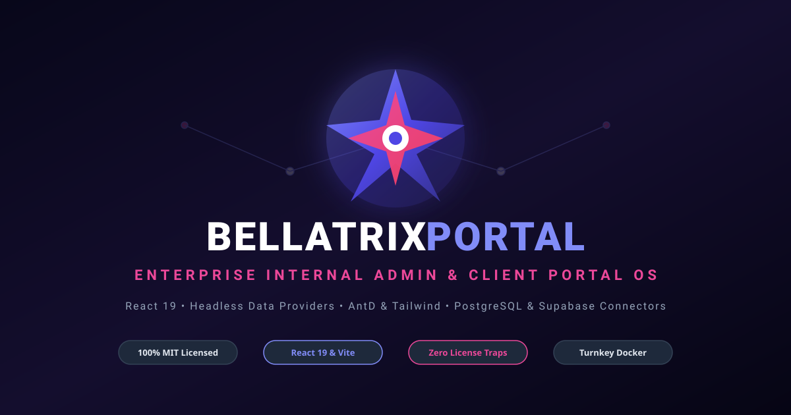

<p align="center">
  <picture>
    <source media="(prefers-color-scheme: dark)" srcset="public/brand/bellatrix-banner.svg">
    <source media="(prefers-color-scheme: light)" srcset="public/brand/bellatrix-banner.svg">
    
  </picture>
</p>

<p align="center">
  <a href="https://github.com/wtfear/BellatrixPortal/actions/workflows/ci.yml">
    
  </a>
  <a href="https://opensource.org/licenses/MIT">
    
  </a>
  <a href="https://react.dev">
    
  </a>
  <a href="https://typescriptlang.org">
    
  </a>
  <a href="https://docker.com">
    
  </a>
</p>

<h1 align="center">BellatrixPortal</h1>

<p align="center">
  <strong>Enterprise Internal Admin &amp; Client Portal OS</strong><br>
  <em>Engineered for B2B Portals, Operations Dashboards, and Custom Back-Offices by WTFear Agency</em>
</p>

---

## 🏛️ Executive Summary

**BellatrixPortal** is an institutional-grade, 100% MIT-licensed internal tools, administration framework, and client portal engine built on **React 19**, **TypeScript**, and headless data provider abstractions.

Unlike restrictive low-code tools (ToolJet is AGPL-3.0, NocoDB uses a commercial-host-prohibiting Sustainable Use License SUL-1.0, and Retool charges \$50/user/mo), BellatrixPortal delivers an unconstrained, pure MIT application foundation. It enables your agency to rapidly build bespoke client portals, fleet management hubs, and operations dashboards over existing PostgreSQL, MySQL, Supabase, or REST/GraphQL backends within days.

### The Agency Commercial Advantage ($25k – $60k+ Engagements)
* **Zero Per-Seat SaaS Taxes:** Host sovereign internal dashboards for 500+ client staff with zero recurring software seat licenses.
* **Headless UI Architecture:** Compatible with Tailwind CSS, Ant Design, Material UI, Chakra UI, and Mantine.
* **Pre-Built Data Connectors:** Instant integrations for PostgreSQL, REST APIs, GraphQL, Supabase, Strapi, and NestJS.
* **Complete License Sovereignty:** 100% pure MIT license with zero copyleft disclosure requirements.

---

## ⚡ Core Operational Architecture

```
                       ┌───────────────────────────────┐
                       │    BELLATRIX PORTAL CORE      │
                       │   (React 19 + TypeScript)     │
                       └──────────────┬────────────────┘
                                      │
       ┌──────────────────┬───────────┴───────────┬──────────────────┐
       ▼                  ▼                       ▼                  ▼
┌──────────────┐   ┌──────────────┐        ┌──────────────┐   ┌──────────────┐
│ DATA ADAPTER │   │ ACCESS (ACL) │        │ UI FRAMEWORK │   │ REALTIME SYNC│
│ • PostgresQL │   │ • Role RBAC  │        │ • Tailwind   │   │ • WebSockets │
│ • Supabase   │   │ • Multi-Org  │        │ • Ant Design │   │ • Optimistic │
│ • GraphQL    │   │ • Audit Log  │        │ • Mantine    │   │ • Polling    │
└──────────────┘   └──────────────┘        └──────────────┘   └──────────────┘
```

---

## 🚀 Quick Start (Docker Compose)

```bash
# 1. Clone repository
git clone https://github.com/wtfear/BellatrixPortal.git
cd BellatrixPortal

# 2. Configure environment
cp .env.example .env

# 3. Launch stack
docker compose up -d
```

Access the portal dashboard at [http://localhost:3000](http://localhost:3000).

---

## 📜 License

BellatrixPortal is open-source software licensed under the **[MIT License](LICENSE)**.
